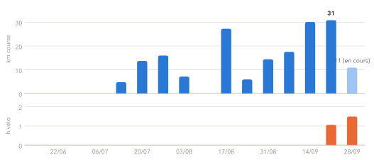
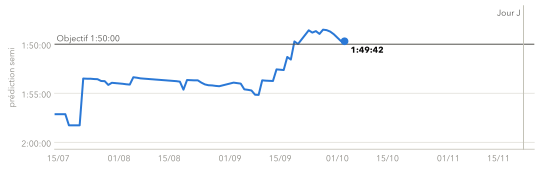
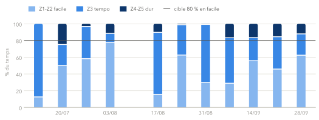
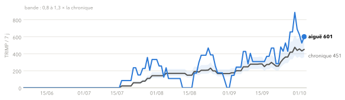

<div align="center">

# 🏃 Run Coach

**Mon coach running perso** · données Garmin · bilans hebdo · programmes sur mesure

<sub>Catégorie : <b>Perso loisir</b> · Stack : Claude Code + Python (uv) + Garmin Connect</sub>

<!-- AUTO:maj:start -->
<sub>Mis à jour le 05/10/2026 · dernière activité : 5 oct. (🏃 9.0 km · 54:24 · 6:02/km · 142 bpm · RPE 6)</sub>
<!-- AUTO:maj:end -->

</div>

---

## 🎯 Objectif en cours

<!-- AUTO:objectif:start -->
<div align="center">

### 🎯 Semi-marathon · 22 nov. 2026
## J-48
**Objectif 1:50:00** · 5:13/km

| 🔮 Prédiction Garmin | 🫁 VO2max | 🔥 Série ≥ 3 sorties/sem. | ✅ Plan cette semaine | 🏃 Km cette semaine |
|:-:|:-:|:-:|:-:|:-:|
| **1:50:03**<br><sub>▼ 4:40 en 4 sem.</sub><br><sub>🟠 0:03 à gagner</sub> | **55** | **0 sem.** | **1/1** ✅ | **9.0** |

`█████████░░░░░░░░░░░░░░░` 41 % de la prépa

</div>
<!-- AUTO:objectif:end -->

## 💬 Le mot du coach

<!-- Section écrite par le coach à la fin de chaque bilan (3 à 5 lignes max). -->
> **05/10 · Moins de séances dures, pas moins de kilomètres.** Ton 1er 2000 m à 5:11 était pile dans la cible ; au 2e, la chaleur
> (+18-20 bpm à allure égale) t'a mis en effort seuil, ralentir était le bon choix. Le souci n'est pas tes footings (bien faits), c'est
> qu'**une séance sur deux est dure** (Pacer + rugby). Proposé : **1 seule séance de qualité par semaine**, le reste vraiment facile.
> Tibia revenu à km 2 : test chaque matin, et s'il revient à la prochaine sortie → kiné ou médecin du sport.

## 📅 La semaine

<!-- AUTO:semaine:start -->
#### Cette semaine · 5 oct. → 11 oct.

| Jour | Prévu | Réalisé | |
|---|---|---|:-:|
| **Lu 5** | 🏃 2 x 3000m allure de course | 🏃 9.0 km · 54:24 · 6:02/km · 142 bpm · RPE 6 | ✅ |
| Ma 6 |  |  |  |
| Me 7 | 🏋️ Renfo A · Jambes solides · 22 min |  | 🗓️ |
| Je 8 | 🏃 7 x 400m (R=1 min) |  | 🗓️ |
|  | 🏋️ Renfo B · Haut du corps + hanches · 21 min |  | 🗓️ |
| Ve 9 |  |  |  |
| Sa 10 |  |  |  |
| Di 11 | 🏃 15km endurance · 15 km |  | 🗓️ |

#### Semaine prochaine · 12 oct. → 18 oct.

| Jour | Prévu | Réalisé | |
|---|---|---|:-:|
| Lu 12 |  |  |  |
| Ma 13 | 🏃 15KM Progressifs |  | 🗓️ |
|  | 🏋️ Renfo A · Jambes solides · 22 min |  | 🗓️ |
| Me 14 |  |  |  |
| Je 15 | 🏃 1 h endurance · 1h00 |  | 🗓️ |
|  | 🏋️ Renfo B · Haut du corps + hanches · 21 min |  | 🗓️ |
| Ve 16 | 🚴 Vélo endurance Z2 · 55 min |  | 🗓️ |
| Sa 17 |  |  |  |
| Di 18 | 🏃 15km endurance · 15 km |  | 🗓️ |

<sub>✅ fait · 🔄 décalé · ❌ manqué · ⏳ aujourd'hui · 🗓️ à venir · ➕ hors plan · 😴 repos</sub>
<!-- AUTO:semaine:end -->

## 📈 Progression

<!-- AUTO:graphs:start -->
### 📊 Volume hebdomadaire
<sub>Kilomètres de course par semaine (semaine en cours en clair) et heures de vélo.</sub>

<picture>
  <source media="(prefers-color-scheme: dark)" srcset="assets/charts/volume-dark.svg">
  
</picture>

### 🔮 Prédiction semi vs objectif
<sub>Prédiction Garmin du temps sur semi. Vers le haut = plus rapide.</sub>

<picture>
  <source media="(prefers-color-scheme: dark)" srcset="assets/charts/prediction-dark.svg">
  
</picture>

### 🌡️ Distribution de l'intensité
<sub>Part du temps passé par zone FC chaque semaine. Repère : ~80 % en facile.</sub>

<picture>
  <source media="(prefers-color-scheme: dark)" srcset="assets/charts/intensite-dark.svg">
  
</picture>

### ⚖️ Charge aiguë vs chronique
<sub>Charge des 7 derniers jours vs moyenne hebdo des 28 derniers. Hors de la bande = semaine inhabituelle (signal, pas verdict).</sub>

<picture>
  <source media="(prefers-color-scheme: dark)" srcset="assets/charts/charge-dark.svg">
  
</picture>

### 🗓️ Régularité
<sub>Minutes d'entraînement par jour sur un an (course, vélo, renfo).</sub>

<picture>
  <source media="(prefers-color-scheme: dark)" srcset="assets/charts/regularite-dark.svg">
  
</picture>
<!-- AUTO:graphs:end -->

## 🏆 Records

<!-- AUTO:records:start -->
| | Distance | Temps | Allure | Date | Séance |
|:-:|---|--:|--:|---|---|
| ⚡ | **1 km** | 3:54 | 3:54/km | 19/09/2026 | [Gy-les-Nonains - Test VMA](https://connect.garmin.com/modern/activity/24415863264) |
| 🥉 | **5 km** | 27:31 | 5:30/km | 10/09/2026 | [Caluire-et-Cuire - 4 x 600m (R=200m)](https://connect.garmin.com/modern/activity/24306388769) |
| 🥈 | **10 km** | 58:55 | 5:53/km | 17/09/2026 | [Caluire-et-Cuire - 2 x 3000m allure de course](https://connect.garmin.com/modern/activity/24399780384) |
| 📏 | **Plus longue sortie** | 13.0 km |  | 27/09/2026 | [Caluire-et-Cuire - 13km endurance](https://connect.garmin.com/modern/activity/24515686494) |
| 🚴 | **Plus longue sortie vélo** | 31 km | 1h29 | 29/09/2026 | [Lyon Cyclisme](https://connect.garmin.com/modern/activity/24543892408) |
| 📈 | **Plus grosse semaine** | 30.8 km | | sem. du 21/09/2026 | |
<!-- AUTO:records:end -->

## 🏅 Achievements

<!-- AUTO:achievements:start -->
**5 / 22 débloqués** `████░░░░░░░░░░░░░░░░`

| | | | |
|:-:|:-:|:-:|:-:|
| 🚴<br>**En selle**<br><sub>Première sortie vélo</sub><br><sub>✅ 24/09/2026</sub> | 🔟<br>**Cap des 10 km**<br><sub>Une sortie de 10 km ou plus</sub><br><sub>✅ 31/08/2025</sub> | 🌅<br>**Lève-tôt**<br><sub>Une sortie commencée avant 7 h</sub><br><sub>✅ 31/08/2025</sub> | 👟<br>**Premiers pas**<br><sub>Première sortie enregistrée</sub><br><sub>✅ 07/08/2025</sub> |
| 🏋️<br>**Premier renfo**<br><sub>Première séance de renforcement</sub><br><sub>✅ 07/08/2025</sub> |  |  |  |

<details><summary>🔒 À débloquer</summary>

| | | | |
|:-:|:-:|:-:|:-:|
| 🔒<br>**Mois à 100 km**<br><sub>100 km de course dans un mois</sub><br><sub>`███████░` meilleur mois 93 / 100 km</sub> | 🔒<br>**Sub 25 au 5 km**<br><sub>Record 5 km sous 25:00</sub><br><sub>`███████░` record 27:31</sub> | 🔒<br>**15 bornes**<br><sub>Une sortie de 15 km ou plus</sub><br><sub>`██████░░` 13.0 / 15.0 km</sub> | 🔒<br>**Sub 50 au 10 km**<br><sub>Record 10 km sous 50:00</sub><br><sub>`██████░░` record 58:55</sub> |
| 🔒<br>**18 bornes**<br><sub>Une sortie de 18 km ou plus</sub><br><sub>`█████░░░` 13.0 / 18.0 km</sub> | 🔒<br>**Semaine polarisée**<br><sub>Une semaine à 3 sorties ou plus avec 80 % du temps en Z1-Z2</sub><br><sub>`█████░░░` meilleure semaine 56 % en Z1-Z2</sub> | 🔒<br>**Distance semi**<br><sub>Courir 21,1 km d'une traite</sub><br><sub>`████░░░░` 13.0 / 21.1 km</sub> | 🔒<br>**Régulier**<br><sub>4 semaines d'affilée avec 3 sorties ou plus</sub><br><sub>`████░░░░` meilleure série 2 / 4 sem.</sub> |
| 🔒<br>**Rouleur régulier**<br><sub>4 semaines d'affilée avec une sortie vélo</sub><br><sub>`████░░░░` meilleure série 2 / 4 sem.</sub> | 🔒<br>**500 km**<br><sub>500 km de course cumulés</sub><br><sub>`███░░░░░` 218 / 500 km</sub> | 🔒<br>**Machine**<br><sub>8 semaines d'affilée avec 3 sorties ou plus</sub><br><sub>`██░░░░░░` meilleure série 2 / 8 sem.</sub> | 🔒<br>**1000 km**<br><sub>1000 km de course cumulés</sub><br><sub>`█░░░░░░░` 218 / 1000 km</sub> |
| 🔒<br>**Grimpeur**<br><sub>500 m de D+ en course sur une semaine</sub><br><sub>`█░░░░░░░` meilleure semaine 95 / 500 m D+</sub> | 🔒<br>**Jambes d'acier**<br><sub>6 semaines d'affilée avec du renfo</sub><br><sub>`█░░░░░░░` meilleure série 1 / 6 sem.</sub> | 🔒<br>**Inarrêtable**<br><sub>16 semaines d'affilée avec 3 sorties ou plus</sub><br><sub>`█░░░░░░░` meilleure série 2 / 16 sem.</sub> | 🔒<br>**Sub 1h50 au semi**<br><sub>L'objectif du 22/11/2026</sub><br><sub>`░░░░░░░░` pas encore de semi</sub> |
| 🔒<br>**Noctambule**<br><sub>Une sortie commencée après 21 h</sub> |  |  |  |

</details>
<!-- AUTO:achievements:end -->

## 🗓️ Programmes

### 📆 Calendrier jusqu'au semi · course + renfo + vélo

<!-- AUTO:programme:start -->
| Semaine | Lu | Ma | Me | Je | Ve | Sa | Di |
|---|---|---|---|---|---|---|---|
| **5 oct.**<br><sub>course dans 6 sem.</sub> 👈 | **🏃 2 x 3000m allure course ✅** |  | 🏋️ Renfo A · 22 min | 🏃 7 x 400m (r 1 min)<br>🏋️ Renfo B · 21 min |  |  | 🏃 15km endurance |
| **12 oct.**<br><sub>course dans 5 sem.</sub> |  | 🏃 15KM Progressifs<br>🏋️ Renfo A · 22 min |  | 🏃 1 h endurance<br>🏋️ Renfo B · 21 min | 🚴 Vélo endurance Z2 · 55 min |  | 🏃 15km endurance |
| **19 oct.**<br><sub>course dans 4 sem.</sub> |  | 🏃 5000m allure course<br>🏋️ Renfo A · 25 min |  | 🏃 55 min endurance<br>🏋️ Renfo B · 23 min | 🚴 Vélo endurance Z2 · 1h05 |  | 🏃 12km endurance |
| **26 oct.**<br><sub>course dans 3 sem.</sub> |  | 🏃 5 x 1500m 90% VMA (r 2 min)<br>🏋️ Renfo A · 25 min |  | 🏃 8 x 500m (r 200m)<br>🏋️ Renfo B · 23 min | 🚴 Vélo endurance Z2 · 1h05 |  | 🏃 16km endurance |
| **2 nov.**<br><sub>course dans 2 sem.</sub> |  | 🏃 30' actives<br>🏋️ Renfo A · 25 min |  | 🏃 Footing pyramidal<br>🏋️ Renfo B · 23 min | 🚴 Vélo endurance Z2 · 1h05 |  | 🏃 17km endurance |
| **9 nov.**<br><sub>course dans 1 sem.</sub> |  | 🏃 8 x (30"/30")<br>🏋️ Renfo A allégé · 15 min | 🚴 Vélo facile Z2 · 45 min | 🏃 13km endurance |  |  | 🏃 2500m allure SPE |
| **16 nov.**<br><sub>semaine de course</sub> |  | 🏃 8km endurance<br>🏋️ Activation (facultatif) · 10 min | 🚴 Vélo très facile (facultatif) · 25 min | 🏃 2000m allure SPE |  | 🏃 20 min footing lent | 🏁 **Semi-marathon** |

<sub>🏃 Kiprun Pacer (synchronisé depuis Garmin) · 🏋️ renfo · 🚴 vélo · ✅ fait · 🔄 décalé · ❌ manqué. 👈 semaine en cours. Le plan Pacer s'adapte : cette grille est régénérée à chaque mise à jour.</sub>
<!-- AUTO:programme:end -->

### 🟦 Kiprun Pacer · plan principal

<!-- Section coach : résumé du bloc en cours (phase, séances clés, volume). Détail dans plans/kiprun.md -->
| Phase | Séances / sem. | Allure semi (Pacer) | Sortie longue max | Affûtage |
|:-:|:-:|:-:|:-:|:-:|
| **Spécifique** | **3** (mar · jeu · dim) | **5:06-5:18/km** | **17 km** le 08/11 | à partir du 10/11 |

**Séances clés à venir** : 15 km progressifs (13/10) · 5000 m allure course (20/10) · 5 × 1500 m à 90 % VMA (27/10) · 17 km dont 4 km allure semi (08/11).

> ⚠️ **Adaptation proposée le 05/10 (en attente de validation)** : 1 seule séance de qualité par semaine (allure semi à 5:13-5:18, jamais plus vite), les séances VMA deviennent footing + lignes droites, sortie longue en facile tant que le tibia n'est pas calme 2 semaines. Le rugby du lundi compte comme la 2e séance dure.
<sub>Plan synchronisé automatiquement depuis le calendrier Garmin (export Kiprun Pacer). Détail semaine par semaine : [plans/kiprun.md](plans/kiprun.md)</sub>

### 🟧 Programme complémentaire · « Prévention semi » · 05/10 → 22/11

<!-- Section coach : programme actif présenté en cartes (voir le format dans plans/complementaire.md). -->
> **But** : des tibias, chevilles et genoux plus solides pour arriver en forme le 22/11, un haut du corps entretenu, et le vélo installé 1x/semaine (en route vers le triathlon).
> **Sans matériel · 2 × 20-25 min de renfo + 1 sortie vélo par semaine** · validé le 03/10/2026.

**Semaine type** (les jours bougent avec tes dispos, les règles restent)

| Lu | Ma | Me | Je | Ve | Sa | Di |
|:-:|:-:|:-:|:-:|:-:|:-:|:-:|
| 😴 | 🏃 Kiprun clé<br>**+ 🏋️ A** | 😴 | 🏃 Kiprun<br>**+ 🏋️ B** | 🚴 Vélo Z2 | 😴 | 🏃 Sortie longue |

<sub>🏋️ A le jour de la séance dure, après la course · 🏋️ B au plus tard 48 h avant la sortie longue · 🚴 jamais la veille de la sortie longue</sub>

**Progression**

| | S1-S2 · 05/10 → 18/10 | S3-S5 · 19/10 → 08/11 | S6 · 09/11 → 15/11 | S7 · semaine du semi |
|---|:-:|:-:|:-:|:-:|
| 🏋️ Renfo | A + B · **2 séries** · 3-4 reps en réserve | A + B · **3 séries** · 2 reps en réserve · descente 3 s | **A allégé** seulement (10/11) | Activation 10 min (17/11), rien dès le 19/11 |
| 🦘 Sauts | ❌ (tibia) | Pogo 2-3 × 10 **si 2 sem. sans douleur** | ❌ | ❌ |
| 🚴 Vélo | 45-60 min Z2 | 60-75 min Z2 | ≤ 60 min (11/11) | 20-30 min Z1 facultatif |

#### 🏋️ Séance A · Jambes solides · 22 min
<sub>Après la séance dure Kiprun · enchaîner 1+3, 2+5, 4, 6+7 · [fiche complète](plans/renfo/prevention-A.md)</sub>

| # | Exercice | Séries × reps | Consigne clé |
|:-:|---|:-:|---|
| 1 | Mollets jambe tendue sur une marche | 2 × 15 | Talons sous la marche, 2 pieds en S1, 1 pied dès S2 |
| 2 | Mollets genou fléchi, face au mur | 2 × 15 | Genoux pliés tout du long : le soléaire protège le tibia |
| 3 | Relevés de pointes contre un mur | 2 × 15-20 | Talons à 30-40 cm du mur, descente lente |
| 4 | Fente bulgare (pied arrière sur une chaise) | 2 × 8 / jambe | Genou dans l'axe du pied, descente 3 s |
| 5 | Pont fessier sur une jambe | 2 × 10 / jambe | Pause 2 s en haut, bassin horizontal |
| 6 | Équilibre sur une jambe | 2 × 30 s / jambe | Yeux fermés quand c'est facile |
| 7 | Gainage latéral | 2 × 30 s / côté | Bassin haut |

<details>
<summary><b>📖 Comment faire chaque exercice de la séance A</b> (pas à pas + vidéos)</summary>

**Comment lire les tableaux** : « 2 × 15 » = 2 séries de 15 répétitions, avec le repos indiqué entre les séries. « 3-4 reps en réserve » = tu t'arrêtes alors que tu pourrais encore en faire 3 ou 4 : ça doit être un effort, jamais un échec.

**1. Mollets jambe tendue sur une marche** · 🎥 [vidéo](https://www.youtube.com/results?search_query=calf+raise+on+step+slow)
- **Départ** : debout sur la première marche d'un escalier, seulement l'avant des pieds sur la marche, les talons dans le vide. Une main sur la rampe pour l'équilibre (pas pour tirer).
- **Mouvement** : jambes tendues, monte sur la pointe des pieds le plus haut possible (2 s), puis redescends lentement (2 s) jusqu'à ce que les talons passent **sous** le niveau de la marche. Ça fait 1 répétition.
- **Tu dois sentir** : le mollet (arrière de la jambe), qui brûle sur les dernières répétitions.
- **Erreur à éviter** : rebondir en bas ou plier les genoux.
- **À partir de S2** : sur un seul pied, l'autre pied replié derrière.

**2. Mollets genou fléchi (soléaire)** · 🎥 [vidéo](https://www.youtube.com/results?search_query=bent+knee+calf+raise+soleus)
- **Départ** : face à un mur, les deux mains posées dessus. Plie les genoux d'environ 30-45° (petite flexion, comme pour t'asseoir un peu) et **garde-les pliés tout du long**.
- **Mouvement** : sans bouger les genoux, monte sur la pointe des pieds (talons décollés), tiens 1 s, redescends lentement.
- **Tu dois sentir** : le bas du mollet, plus profond, près du tendon d'Achille. C'est le soléaire, le muscle qui encaisse les chocs de la course et protège le tibia.
- **Erreur à éviter** : tendre les jambes en montant (ça redevient l'exercice 1).

**3. Relevés de pointes contre un mur (tibial)** · 🎥 [vidéo](https://www.youtube.com/results?search_query=tibialis+raise+against+wall)
- **Départ** : dos et fesses appuyés contre un mur, pieds écartés largeur de hanches, à 30-40 cm devant le mur, jambes tendues, talons au sol.
- **Mouvement** : relève le bout des pieds (orteils vers les tibias) le plus haut possible en gardant les talons au sol, tiens 1 s, redescends lentement sans laisser les pieds claquer.
- **Tu dois sentir** : le devant de la jambe, le muscle juste à côté de l'os du tibia, qui chauffe vite.
- **Plus dur** : pieds plus loin du mur, puis un pied à la fois.

**4. Fente bulgare** · 🎥 [vidéo](https://www.youtube.com/results?search_query=bulgarian+split+squat+bodyweight)
- **Départ** : dos à une chaise ou un canapé, à environ un grand pas devant. Pose le **dessus** du pied arrière sur l'assise (lacets vers le bas). Le pied avant est bien à plat, orienté droit devant.
- **Mouvement** : descends en 3 s en pliant les deux genoux, comme si tu voulais poser le genou arrière au sol, jusqu'à ce que la cuisse avant soit presque horizontale. Remonte en poussant dans le talon du pied avant. Fais toutes les répétitions d'une jambe, puis change.
- **Tu dois sentir** : la cuisse et la fesse de la jambe **avant**.
- **Erreurs à éviter** : genou avant qui rentre vers l'intérieur (il reste dans l'axe du pied) ; pied avant trop près de la chaise (le talon décolle) → avance-le.
- **Plus facile** : fente arrière au sol, le pied arrière posé par terre.

**5. Pont fessier sur une jambe** · 🎥 [vidéo](https://www.youtube.com/results?search_query=single+leg+glute+bridge)
- **Départ** : allongé sur le dos, genoux pliés, pieds à plat à environ 20 cm des fesses, bras au sol le long du corps. Lève une jambe, genou vers la poitrine.
- **Mouvement** : pousse dans le **talon** du pied au sol pour monter le bassin jusqu'à ce que épaules, bassin et genou soient alignés. Tiens 2 s en haut, redescends lentement.
- **Tu dois sentir** : la fesse de la jambe d'appui (un peu l'arrière de la cuisse, c'est normal).
- **Erreurs à éviter** : cambrer le bas du dos, laisser le bassin pencher d'un côté.
- **Plus facile** : les deux pieds au sol.

**6. Équilibre sur une jambe** · 🎥 [vidéo](https://www.youtube.com/results?search_query=single+leg+balance+ankle+exercise)
- **Départ** : pieds nus, debout sur une jambe, genou très légèrement fléchi, bassin horizontal, regard droit devant.
- **Mouvement** : tiens 30 s sans poser l'autre pied. Trop facile ? Yeux fermés, puis debout sur un coussin ou un oreiller plié.
- **Tu dois sentir** : la cheville et le pied qui corrigent en permanence. C'est exactement le but : ça entraîne les réflexes qui évitent les entorses.

**7. Gainage latéral** · 🎥 [vidéo](https://www.youtube.com/results?search_query=forearm+side+plank+form)
- **Départ** : allongé sur le côté, appuyé sur l'avant-bras, coude juste sous l'épaule, jambes tendues l'une sur l'autre.
- **Mouvement** : soulève le bassin pour former une ligne droite de la tête aux pieds, tiens 30 s, puis l'autre côté.
- **Tu dois sentir** : le côté du ventre et la hanche du dessous.
- **Erreur à éviter** : bassin qui s'affaisse ou qui part vers l'arrière.
- **Plus facile** : genoux pliés et posés au sol.

**À partir de S3, si le tibia ne fait plus mal depuis 2 semaines : pogo** · 🎥 [vidéo](https://www.youtube.com/results?search_query=pogo+jumps+for+runners)
- Petits rebonds sur place sur l'avant des pieds, chevilles toniques, genoux presque tendus, contacts au sol très courts, comme à la corde à sauter sans corde. 2 × 10 en **début** de séance A, sur un sol pas trop dur.

</details>

#### 🏋️ Séance B · Haut du corps + hanches + pieds · 21 min
<sub>Après la 2e sortie Kiprun, ≥ 48 h avant la sortie longue · enchaîner 1+4, 2+5, 3+6, 7+8 · [fiche complète](plans/renfo/prevention-B.md)</sub>

| # | Exercice | Séries × reps | Consigne clé |
|:-:|---|:-:|---|
| 1 | Pompes | 2 × 8-12 | Corps gainé ; mains sur une chaise si trop dur |
| 2 | Rowing sous une table solide | 2 × 8-12 | Poitrine vers le plateau, omoplates serrées (table stable !) |
| 3 | Dips sur chaise | 2 × 8-10 | Amplitude confortable pour les épaules |
| 4 | Descente lente d'une marche | 2 × 8 / jambe | 3 s, genou dans l'axe du 2e orteil |
| 5 | Abduction de hanche couché sur le côté | 2 × 15 / côté | Jambe légèrement en arrière |
| 6 | Mollet genou fléchi tenu (1 pied) | 2 × 30-45 s / jambe | Immobile à mi-hauteur, effort 70-80 % |
| 7 | Dead bug | 2 × 8 / côté | Dos plaqué, expirer en allongeant |
| 8 | Pied court | 1 × 6 × 5 s / pied | Arche raccourcie, orteils détendus |

<details>
<summary><b>📖 Comment faire chaque exercice de la séance B</b> (pas à pas + vidéos)</summary>

**1. Pompes** · 🎥 [vidéo](https://www.youtube.com/results?search_query=push+up+proper+form+beginner)
- **Départ** : mains au sol un peu plus écartées que les épaules, bras tendus, corps droit de la tête aux pieds (ventre et fesses serrés).
- **Mouvement** : plie les coudes, qui partent vers l'arrière en diagonale (pas sur les côtés), pour descendre la poitrine près du sol en 2 s, puis repousse.
- **Tu dois sentir** : les pectoraux, l'arrière des bras, les épaules.
- **Erreurs à éviter** : fesses en l'air ou dos qui se creuse.
- **Plus facile** : mains sur une table ou une chaise calée contre un mur, ou genoux au sol.

**2. Rowing sous une table** · 🎥 [vidéo](https://www.youtube.com/results?search_query=inverted+row+under+table+at+home)
- **Sécurité d'abord** : une table **lourde et stable**. Teste en tirant doucement : si elle bouge, passe à la variante Y-T-W ci-dessous.
- **Départ** : allongé sur le dos sous la table, la poitrine sous le bord. Attrape le bord du plateau, mains écartées largeur d'épaules, bras tendus. Genoux pliés et pieds à plat (plus facile) ou jambes tendues (plus dur).
- **Mouvement** : tire ta poitrine vers le bord de la table en serrant les omoplates l'une contre l'autre, le corps reste droit. Redescends lentement.
- **Tu dois sentir** : le milieu du dos et l'arrière des épaules.
- **Variante Y-T-W** (sans table) 🎥 [vidéo](https://www.youtube.com/results?search_query=prone+Y+T+W+exercise) : allongé sur le ventre, front sur une serviette, lève les bras du sol en forme de Y, puis de T, puis de W, pouces vers le plafond, 2 s en haut à chaque fois. Y + T + W = 1 répétition.

**3. Dips sur chaise** · 🎥 [vidéo](https://www.youtube.com/results?search_query=chair+dips+triceps+beginner)
- **Départ** : chaise stable calée contre un mur. Assis au bord, mains sur l'assise de chaque côté des fesses, doigts vers l'avant. Avance les fesses dans le vide, genoux pliés, pieds au sol.
- **Mouvement** : plie les coudes (ils partent vers l'arrière) pour descendre les fesses vers le sol, jusqu'à environ 90° aux coudes, puis remonte en poussant.
- **Tu dois sentir** : l'arrière des bras (triceps).
- **Erreur à éviter** : descendre trop bas. Si l'avant de l'épaule tire, réduis l'amplitude.

**4. Descente lente d'une marche** · 🎥 [vidéo](https://www.youtube.com/results?search_query=step+down+exercise+knee+control)
- **Départ** : debout sur une jambe sur la première marche d'un escalier, l'autre jambe dans le vide devant ou sur le côté. Une main sur la rampe si besoin.
- **Mouvement** : plie la jambe d'appui pour descendre lentement (3 s) le talon libre jusqu'à **effleurer** le sol, sans t'y appuyer, puis remonte en poussant dans la jambe d'appui.
- **Le point clé** : le genou d'appui reste aligné avec le 2e orteil, il ne rentre pas vers l'intérieur. Fais-le face à un miroir les premières fois.
- **Tu dois sentir** : la cuisse et la fesse de la jambe d'appui.

**5. Abduction de hanche couché sur le côté** · 🎥 [vidéo](https://www.youtube.com/results?search_query=side+lying+hip+abduction+correct+form)
- **Départ** : allongé sur le côté, la jambe du dessous pliée pour être stable, la jambe du dessus tendue dans le prolongement du corps (ou légèrement en arrière).
- **Mouvement** : monte la jambe du dessus de 30-40 cm, sans tourner le pied vers le plafond (orteils vers l'avant, voire un peu vers le sol), tiens 1 s, redescends lentement.
- **Tu dois sentir** : le côté de la fesse, qui brûle vite. Normal : c'est le muscle qui stabilise le genou quand tu cours.
- **Erreurs à éviter** : basculer le bassin vers l'arrière, lever la jambe vers l'avant.

**6. Mollet genou fléchi tenu (isométrie)** · 🎥 [vidéo](https://www.youtube.com/results?search_query=isometric+bent+knee+calf+raise+hold)
- **Départ** : face à un mur, mains dessus, debout sur une jambe, genou plié d'environ 30°.
- **Mouvement** : monte le talon à mi-hauteur et **tiens immobile** 30 à 45 s, effort soutenable (environ 70-80 %). Puis l'autre jambe.
- **Tu dois sentir** : le bas du mollet qui chauffe. Le tibia ne doit pas faire mal ; si c'est le cas, réduis la durée.

**7. Dead bug** · 🎥 [vidéo](https://www.youtube.com/results?search_query=dead+bug+exercise+form)
- **Départ** : sur le dos, bras tendus vers le plafond, hanches et genoux pliés à 90° (tibias parallèles au sol), le bas du dos **plaqué** au sol.
- **Mouvement** : en soufflant, allonge lentement le bras droit vers l'arrière et la jambe gauche vers l'avant, sans toucher le sol, le dos reste collé. Reviens, puis l'autre côté. 1 côté = 1 répétition.
- **Erreur à éviter** : le bas du dos qui se décolle. Si ça arrive, allonge moins loin.

**8. Pied court** · 🎥 [vidéo](https://www.youtube.com/results?search_query=short+foot+exercise)
- **Départ** : assis, pied nu à plat au sol.
- **Mouvement** : sans plier les orteils, « raccourcis » ton pied en rapprochant la base du gros orteil du talon : la voûte plantaire se creuse. Tiens 5 s, relâche. 6 fois par pied.
- **Tu dois sentir** : la voûte plantaire qui travaille. C'est subtil au début, c'est normal.

</details>

#### 🚴 Vélo endurance Z2 · 45-75 min
Sur le plat · tu dois pouvoir **parler en phrases complètes** (RPE 4-5/10) · cadence 85-95 tr/min · assis et petit braquet dans les côtes.
Peut remplacer une sortie facile si le tibia fait mal, **jamais** la sortie longue.

> ✅ **On progresse** : aucune courbature au-delà de 48 h, aucune douleur le lendemain. · ⚠️ **On allège** : jambes lourdes le jour de la sortie longue, tibia > 3/10. · 🏃 **La course passe toujours avant le renfo.**
> 🦵 **Avant chaque sortie** : le test du tibia (palpation, marche, 10 sauts sur une jambe, détail dans 🩹 Santé). Douleur aux sauts → vélo facile à la place. · ⌚ Lance l'activité « Musculation » sur la montre pour que le renfo remonte dans les bilans.

<sub>Détail et règles : [plans/complementaire.md](plans/complementaire.md) · Bibliothèque renfo : [plans/renfo/](plans/renfo/)</sub>

## 🩹 Santé

<!-- Section coach : douleurs ou blessures suivies, avec statut et date. -->
| Zone | Depuis | Intensité | Statut | Conduite à tenir |
|---|---|:-:|:-:|---|
| Tibia (douleur diffuse le long de l'os, apparue en courant) | 03/10/2026, **revenue le 05/10** (km 2, calmée après une pause) | 0 au test du 04/10 · note du 05/10 à préciser | 🟠 | **Test du tibia** chaque matin et avant chaque sortie (ci-dessous). Pas de rugby le soir d'une séance. **Si elle revient à la prochaine sortie → kiné ou médecin du sport**, vélo en attendant. Point précis, douleur à la marche ou la nuit → arrêt et médecin |
| Cheville | 01/10/2026 | légère | 🟡 | Surveiller ; renfo cheville à venir |
| Genoux | récurrent | légère | 🟡 | Échauffement systématique ; renfo hanches et quadriceps à venir |

<details>
<summary>🦵 <b>Le test du tibia</b> (2 min, avant chaque sortie et au réveil)</summary>

1. **Palpation** (assis, jambe détendue) : appuie fermement du bout des doigts tous les 2-3 cm le long du **bord intérieur du tibia**, du genou à la cheville. Compare avec l'autre jambe. Note si c'est sensible sur **une bande** (plusieurs cm) ou sur **un point précis** que tu peux montrer avec un doigt.
2. **Marche** : 1 min de marche rapide, puis quelques marches d'escalier en montée et en descente.
3. **Sauts** : 10 petits sauts sur place sur la jambe douloureuse (5-10 cm de haut, sur l'avant du pied), puis 10 sur l'autre jambe pour comparer. Note la douleur /10.

| Résultat | Décision |
|---|---|
| 🟢 Rien, ou bande un peu sensible à la palpation seulement (≤ 2/10), sauts indolores | Course OK selon le plan, règle des 3/10 pendant la séance |
| 🟠 Douleur aux sauts (même diffuse) | Pas de course ce jour-là → vélo facile. Si ça dure plus de 3 jours → kiné ou médecin |
| 🔴 Point précis douloureux, douleur à la marche, la nuit ou au repos | Stop course et **médecin** (fracture de fatigue à éliminer) |

</details>

## 📊 Totaux

<!-- AUTO:totaux:start -->
| | 2026 | Depuis le début |
|---|--:|--:|
| 🏃 Course | **188 km** · 24 sorties · 19 h | **218 km** · 31 sorties · 22 h |
| ⛰️ D+ course | 515 m | 533 m |
| 🚴 Vélo | 56 km · 2 sorties · 3 h | 56 km · 2 sorties · 3 h |
| 🏋️ Renfo | 0 séances | 1 séances |
<!-- AUTO:totaux:end -->

---

## 🛠️ Fonctionnement

<details>
<summary><b>Comment ça marche</b></summary>

```
Montre Garmin ──► Garmin Connect ──► scripts/sync.py ──► data/*.csv ──► report.py ──► le coach (Claude Code)
Kiprun Pacer ──► export séance ──┘   (hook : à chaque question,           │                       │
                                       1 fois / 30 min max)               └► build_readme.py ──► ce README
```

- **Je pose mes questions dans Claude Code**, dans ce dossier. Un hook synchronise Garmin automatiquement (au plus toutes les 30 min).
- **Le coach** lit `CLAUDE.md` (ses instructions), le résumé de `JOURNAL.md`, mon profil, puis le bilan généré par `report.py`.
- **Source des données : Garmin Connect** (course, vélo, FC, HRV, sommeil, VO2max, prédictions, séances planifiées). Strava n'est pas utilisé : depuis le 01/06/2026 sa politique API interdit d'injecter ses données dans une IA (§5.3).
- **Kiprun Pacer n'a pas d'API** : les séances exportées vers Garmin remontent toutes seules ; sinon je dépose une capture du plan dans `plans/kiprun/captures/`.

</details>

<details>
<summary><b>Commandes</b></summary>

| Commande | Rôle |
|---|---|
| `uv run scripts/garmin_login.py` | Connexion Garmin (une seule fois, MFA géré, jetons dans `~/.garminconnect/`) |
| `uv run scripts/sync.py` | Sync incrémentale (`--full` pour tout l'historique, `--normalize-only` sans réseau) |
| `uv run scripts/report.py` | Bilan brut S-1 / S / S+1 pour le coach |
| `uv run scripts/checkin.py --sommeil 4 --fatigue 2 …` | Enregistre un ressenti du jour |
| `uv run scripts/build_readme.py` | Régénère graphs et blocs automatiques de ce README |
| `/bilan` · `/programme` (dans Claude Code) | Bilan complet guidé · créer ou ajuster un programme |

</details>

<details>
<summary><b>Où est quoi</b></summary>

| Fichier | Contenu |
|---|---|
| [CLAUDE.md](CLAUDE.md) | Instructions du coach (rôle, routine, règles de sécurité) |
| [JOURNAL.md](JOURNAL.md) | Tout l'historique : sessions, ressentis, décisions et leurs raisons |
| [athlete/profil.md](athlete/profil.md) · [athlete/objectifs.md](athlete/objectifs.md) | Fiche athlète et objectifs |
| [plans/](plans/) | Plan Kiprun transcrit, programme complémentaire, bibliothèque renfo |
| [knowledge/](knowledge/) | Base de connaissances coaching, sourcée (méthode, semi, blessures, récup, renfo, vélo) |
| `data/` | Données Garmin normalisées (CSV/JSON), check-ins, séances prévues |
| `scripts/` | Sync, bilan, graphs, README |

</details>

<details>
<summary><b>Installation sur une nouvelle machine</b></summary>

1. Installer [uv](https://docs.astral.sh/uv/), puis `uv sync` dans ce dossier.
2. `uv run scripts/garmin_login.py` (email, mot de passe, code MFA).
3. `uv run scripts/sync.py --full` pour rapatrier l'historique, puis `uv run scripts/build_readme.py`.
4. Kiprun Pacer : Garmin Connect → Paramètres → Applications connectées → Decathlon → autoriser « Entraînement », puis « Exporter » sur les séances dans Pacer.

</details>
